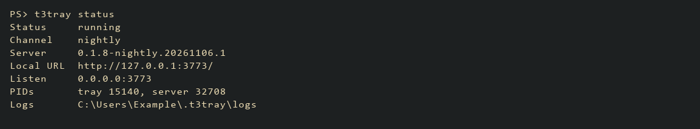

# t3tray

Run the T3 Code server from your Windows system tray. Start it at sign-in, see
its status, and manage server updates from T3 Code's **Update machines** dialog.

Unofficial. Not affiliated with T3 Code or Ping Labs.

## Install

You need Windows 10 or 11 x64, PowerShell 5.1 or newer, and an internet connection.
Run this as the Windows user who uses T3 Code:

```powershell
irm https://raw.githubusercontent.com/AkiVonAkira/t3tray/main/install.ps1 | iex
```

The installer detects your settings and walks you through the server channel,
network access, port, and sign-in startup. Review the changes, then install.
Only the optional Private-network firewall rule asks for administrator approval.
Rust is not required.

When setup finishes, check the server:

```powershell
t3tray status
```

If PowerShell cannot find `t3tray`, add `%USERPROFILE%\.t3\bin` to your user
`PATH`, or run the installed wrapper directly:

```powershell
& "$env:USERPROFILE\.t3\bin\t3tray.cmd" status
```

In the T3 desktop app, turn off **Local environment** and pair the app with this
server. The default address on this PC is http://127.0.0.1:3773/.

The tray runs while you are signed in. It does not start before sign-in after a
reboot. Keep a desktop session signed in when installing over SSH.

## Use the tray or terminal

The tray menu has **Restart server**, **Stop server**, **Start server**, **Open
logs**, and **Quit**. Green means ready, amber means starting or waiting, and red
means stopped.

Run `t3tray` with no command to list the commands.

| Command | What it does |
| --- | --- |
| `t3tray status` | Shows server status, address, and logs. |
| `t3tray status --json` | Returns JSON for scripts and agents. |
| `t3tray restart` | Restarts the server and waits for readiness. |
| `t3tray stop` | Stops the server; keeps the tray open. |
| `t3tray start` | Starts the server and waits for readiness. |
| `t3tray quit` | Closes the tray and stops its server processes. |
| `t3tray update` | Updates t3tray to the latest release and keeps its settings. |
| `t3tray help` | Lists the commands and run options. |



[See the installer screens](docs/screenshots/README.md). The captures use example
data; the completion preview simulates installation steps.

Wait for active agent turns to finish before stopping, restarting, quitting, or
updating. These actions can terminate their work.

## Update or troubleshoot

Use **Update machines** in T3 Code to update the server. Run `t3tray update` to
update t3tray itself. It keeps the listen address, port, channel, T3 home, and
sign-in startup setting. Updating the desktop app does not update this standalone
server.

t3tray v0.1.1 and older have no `update` command. Re-run the installer once to
reach v0.2.0. The installer reads the existing sign-in entry and suggests its settings.

If setup fails, read the failed step and check these logs:

```powershell
Get-Content "$env:USERPROFILE\.t3tray\logs\t3tray.log" -Tail 40
Get-Content "$env:USERPROFILE\.t3tray\logs\server.log" -Tail 40
```

For LAN access, choose **LAN** in the installer and allow only the networks you
trust. Keep T3 authentication enabled. The executable is unsigned, so Windows
SmartScreen may warn about it. See [security notes](SECURITY.md).

## Uninstall

Download [uninstall.ps1](https://raw.githubusercontent.com/AkiVonAkira/t3tray/main/uninstall.ps1)
and run it in PowerShell:

```powershell
& .\uninstall.ps1
```

This removes the tray, its startup entry, and its command wrapper. It keeps logs
and all T3 projects, sessions, runtimes, and credentials in `.t3`.
Add `-Purge` to remove `.t3tray` and its logs too.

## More detail

- [Installer flags, unattended setup, paths, and update behavior](docs/reference.md)
- [Instructions for agents setting up or changing t3tray](AGENTS.md)
- [Release history](CHANGELOG.md)

ARM64 and update rollback are untested. Windows update handoff stops the old
server without a graceful SIGTERM; its children can linger until the tray restarts.
