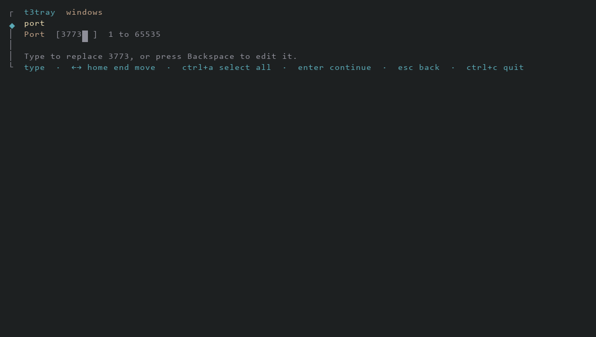
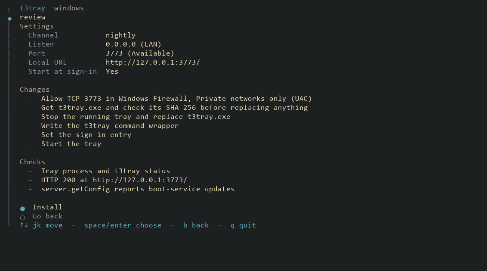
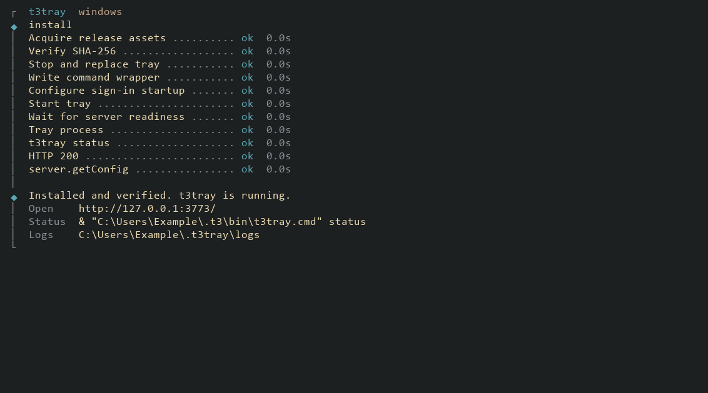
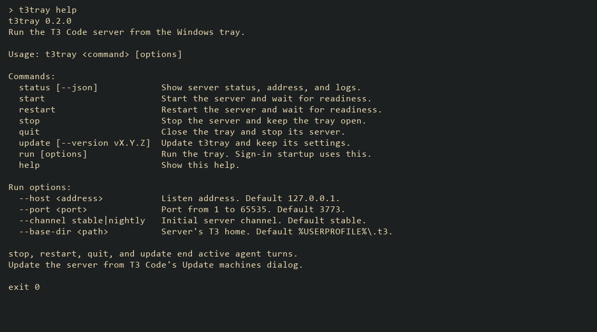
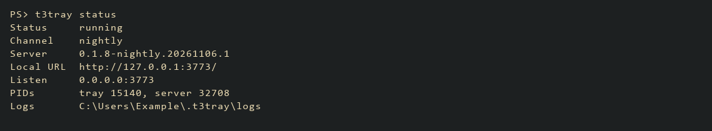

# Installer screens

These captures show the production controls in Windows PowerShell 5.1, inside a
headless terminal at 110 columns and 29 rows. The terminal output is rendered
with Consolas and the installer's colors. All paths and server state use fixture
data. No installation, firewall change, or tray startup runs for these captures.

## Enter a port

Type to replace the suggested port, or press Enter to keep it. Backspace edits
the suggestion; arrow keys move within the field.

## Review the changes

Settings, installation changes, and checks have separate groups. The LAN example
includes the Private-network firewall rule.

## Finish setup

This preview calls the progress and summary renderers with simulated successful
steps. A real interactive installation shows success after verification passes.

## List the commands

`t3tray` with no command prints this help and exits without starting the tray.

## Check the server

This is the real `status` executable reading fixture state under an isolated
profile and mutex. Scripts use `status --json`.

To exercise the wizard and preview without changing your system, run
`powershell.exe -NoProfile -File scripts/installer-preview.ps1` from the repo root.
